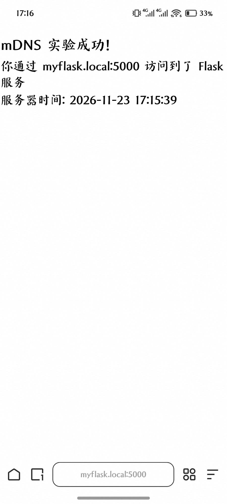

# 局域网零配置域名访问实验：mDNS + DNS 兜底

在局域网内，让手机 / 平板 / 笔记本**不做任何配置、不安装任何东西**，直接用
`http://myflask.local:5000` 访问电脑（服务器）上的 Flask 应用。

> 实验环境：Windows 11（服务器端）+ Android 12 手机（客户端）+ 家庭/办公 WiFi 路由器
> 实验结果：**成功**。手机连电脑热点后，浏览器直接访问 `http://myflask.local:5000`：



---

## 1. 问题与分析

**目标**：A 机器跑 Flask（端口 5000），局域网内其他设备用临时域名 `myflask.local` 访问，客户端零修改。

**为什么"自己写一个 DNS 服务器"行不通（普通 WiFi 场景）**：
客户端的 DNS 服务器是路由器通过 DHCP 下发的，它们只会去问路由器配置的那个 DNS，
根本不会来问 A 机器上的 DNS 服务。要让客户端来问 A 机器，就必须改客户端配置（违反零修改约束）。

**mDNS 是唯一满足约束的标准机制**：客户端操作系统原生内置 `.local` 域名解析能力，
解析时直接向局域网组播地址 `224.0.0.251:5353` 发查询包，不需要配置任何 DNS 服务器。
只需要在服务器侧跑一个小程序应答查询即可——改动全部在服务器侧。

**各平台 `.local` 原生解析支持**：

| 平台 | 支持 |
|---|---|
| Windows 10 1803+ / 11 | ✅ 内置 |
| macOS / iOS | ✅ 内置（Bonjour） |
| Linux 桌面（Avahi） | ✅ |
| Android 12+ | ✅ 系统级支持（实际测试参差，见踩坑实录） |
| Android 11 及以下 | ⚠️ 支持很差 |

## 2. 两种方案

| | 方案 A：普通 WiFi + mDNS | 方案 B：电脑热点 + DNS 接管（本实验最终方案） |
|---|---|---|
| 前提 | 路由器未开 AP 隔离，客户端 mDNS 可靠 | Windows 电脑可开移动热点 |
| 客户端 | 连路由器 WiFi | 连电脑热点（仍可正常上网，电脑 NAT 共享） |
| 解析方式 | mDNS 组播应答 | DNS 服务器应答（mDNS 同时并存） |
| 可靠性 | 依赖路由器和手机系统 | 高，不依赖路由器与手机 mDNS 实现 |

**推荐**：先试方案 A（改动最小）；如果手机解析不了 `.local` 或路由器开了 AP 隔离，直接上方案 B。

## 3. 快速开始（方案 B：热点模式，成功率最高）

### 3.1 安装依赖

```bash
pip install -r requirements.txt
```

### 3.2 启动三个服务（三个终端窗口）

```bash
# 终端 1：Flask 应用（换成你自己的 app 也行，监听 0.0.0.0 是关键）
python src/server.py
```

```bash
# 终端 2：mDNS 应答器（注册 myflask.local -> 热点 IP + WiFi IP）
python src/mdns_register.py --ip "192.168.137.1,10.21.149.173"
```

```bash
# 终端 3：DNS 服务器（myflask.local 本地应答，其余域名转发 223.5.5.5）
python src/dns_server.py
```

### 3.3 开启 Windows 移动热点（记录输出的 SSID 和密码）

```powershell
powershell -ExecutionPolicy Bypass -File .\scripts\hotspot_on.ps1
```

### 3.4 放行防火墙（**管理员** PowerShell）

```powershell
powershell -ExecutionPolicy Bypass -File .\scripts\add_firewall_rules.ps1
```

放行 TCP 5000（Flask）和 UDP 5353（mDNS），均限定 `remoteip=localsubnet` 只对本网段开放。

### 3.5 把 WLAN 网卡 DNS 指向本地 DNS 服务器（**管理员** PowerShell）

```powershell
powershell -ExecutionPolicy Bypass -File .\scripts\set_dns.ps1 -Address 127.0.0.1
```

> **为什么改这一步**：Windows 热点会把 WLAN 网卡的 DNS 直接下发给手机。
> 改成 `127.0.0.1` 后，热点下发给手机的 DNS 链路最终会到达我们的 DNS 服务器。
> ⚠️ 不要填 `192.168.137.1`：Windows 热点自带的 DNS 组件也监听 53 端口，
> 它的上游跟随网卡 DNS，填 137.1 会让它"转发给自己"形成死循环（返回 NXDOMAIN）。

### 3.6 手机连接热点并访问

1. 手机连上热点输出的 SSID（名称和密码以 `scripts/hotspot_on.ps1` 的输出为准，开启热点前可在 Windows 设置 → 移动热点 中修改）
2. 浏览器访问 `http://myflask.local:5000`
3. 如果失败：**关闭再打开手机 WiFi**（强制重新获取 DHCP，刷新 DNS 配置）后重试；
   浏览器可能缓存了旧的失败结果，用无痕模式或换浏览器

### 3.7 验证

- 电脑侧：`nslookup myflask.local 192.168.137.1` 应返回 `192.168.137.1`
- 手机侧：打开实验页面，显示 "mDNS 实验成功!"

## 4. 方案 A：普通 WiFi + mDNS（简单场景）

1. 完成上面 3.1、3.2（终端 1、2）、3.4
2. mDNS 注册只填 WiFi IP：`python src/mdns_register.py`（自动探测）
3. 手机连**同一个路由器 WiFi**，浏览器访问 `http://myflask.local:5000`

**适用条件**：路由器没开 AP 隔离 + 手机系统/浏览器对 mDNS 支持良好（iPhone、Windows、macOS 一般没问题）。

**不适用**：路由器开了 AP 隔离（WiFi 设备间禁止互访，组播也过不去）——这正是本实验最初失败的原因，
最终切换到了方案 B。

## 5. 踩坑实录（重要经验）

1. **防火墙拦截**：Windows 默认不放行 TCP 5000 和 UDP 5353 入站，局域网设备一律连不上。
   加防火墙规则（见 3.4），`remoteip=localsubnet` 限定本网段。
2. **路由器 AP 隔离**：WiFi 设备间无法互访，mDNS 组播也过不去。表现为 IP 直连也不通。
   解决：换用电脑热点（手机直连电脑，无隔离）。
3. **Android 12 手机解析不了 `.local`**：理论上 Android 12+ 支持系统级 mDNS 解析，
   实测国产手机浏览器在热点场景下 `.local` 解析失败（IP 直连正常）。
   解决：DNS 服务器兜底，不依赖手机 mDNS。
4. **Windows 热点把 WLAN 网卡 DNS 直接下发给手机**：热点 DHCP 下发的 DNS = WLAN 网卡的 DNS
   （实验中是 `10.3.9.6/5/4`），所以手机查 `.local` 问的是路由器 DNS，当然查不到。
   解决：改网卡 DNS 引流（见 3.5）。
5. **53 端口双监听与死循环**：Windows 热点自带 DNS 组件也监听 53 端口，会抢答 137.1 上的查询；
   它的上游跟随网卡 DNS——网卡 DNS 若填 `192.168.137.1` 就自环，全部返回 NXDOMAIN。
   解决：网卡 DNS 填 `127.0.0.1`（热点组件转发给我们的 DNS 服务器，再由我们转发公共 DNS）。
6. **手机 DHCP 租约缓存**：手机快速关开 WiFi 会复用旧租约，拿不到新 DNS。
   解决：重启热点强制 DHCP 重新分配（`scripts/hotspot_restart.ps1`），或手机"忽略此网络"后重连。
7. **PowerShell 5.1 编码坑**：Windows PowerShell 按 ANSI/GBK 读取 UTF-8（无 BOM）脚本，
   中文注释/字符串会破坏语法。**.ps1 脚本一律写纯 ASCII**。
8. **包名陷阱**：mDNS 库的 pip 包名是 `zeroconf`，不是 `python-zeroconf`。

**DNS 链路总览（方案 B 最终架构）**：

```
手机浏览器输入 http://myflask.local:5000
        │
        ▼ 手机系统 DNS 查询（发往热点下发的 DNS）
192.168.137.1:53 ──► src/dns_server.py（本地应答 myflask.local -> 192.168.137.1）
        │                └─ 其他域名 ──► 转发 223.5.5.5（手机正常上网不受影响）
        ▼ 手机拿到 IP，直连 192.168.137.1:5000
Flask 响应 ✅
（同时 mDNS 应答器在 UDP 5353 并存应答，支持 mDNS 的设备走组播解析）
```

## 6. 文件清单

| 文件 | 说明 |
|---|---|
| `src/server.py` | Flask 测试应用（`/` 与 `/health`，监听 `0.0.0.0:5000`），可替换成你自己的 app |
| `src/mdns_register.py` | mDNS 应答器，注册 `.local` 域名的 A/SRV 记录，支持 `--name/--ip/--port` |
| `src/dns_server.py` | 极简 DNS 服务器：`myflask.local` 本地应答，其余转发上游（默认 `223.5.5.5`），带查询日志 |
| `scripts/hotspot_on.ps1` | 开启 Windows 移动热点（输出 SSID/密码），PowerShell 调 WinRT API |
| `scripts/hotspot_restart.ps1` | 重启热点（强制手机 DHCP 刷新） |
| `scripts/add_firewall_rules.ps1` | 添加防火墙入站规则（管理员运行） |
| `scripts/set_dns.ps1` | 设置/回滚 WLAN 网卡 DNS（管理员运行） |
| `requirements.txt` | Python 依赖：flask、zeroconf、dnslib |
| `docs/images/success_screenshot.jpg` | 手机成功访问的截图 |

### mdns_register.py 参数

```bash
python src/mdns_register.py --name myflask --ip "192.168.137.1,10.21.149.173" --port 5000
```

- `--name`：域名主体（不含 `.local` 后缀），默认 `myflask`
- `--ip`：要宣告的 IP，多个用逗号分隔；默认自动探测默认路由出口 IP
- `--port`：SRV 记录中的端口，默认 5000

### dns_server.py 参数

```bash
python src/dns_server.py [上游DNS]     # 默认 223.5.5.5
```

## 7. 回滚与清理

```powershell
# 恢复 WLAN 网卡 DNS 为 DHCP 自动获取（管理员）
powershell -ExecutionPolicy Bypass -File .\scripts\set_dns.ps1 -Address dhcp
```

```bash
# 删除防火墙规则（管理员）
netsh advfirewall firewall delete rule name="Flask 5000 TCP"
netsh advfirewall firewall delete rule name="mDNS 5353 UDP"
```

热点在 设置 → 网络和 Internet → 移动热点 中关闭；三个终端 Ctrl+C 停止服务。

## 8. 已知限制

- **仅供实验/内网使用**：`dns_server.py` 无鉴权，53 端口对本网段开放；Flask 为开发服务器，
  生产环境请用 gunicorn/waitress。
- **依赖链脆弱**：方案 B 中 DNS 服务器进程若退出，手机和电脑的域名解析都会中断
  （回滚 DNS 设置即可恢复）。
- **改网卡 DNS 影响本机解析**：所有查询经自定义 DNS 转发，若上游公共 DNS 被墙/变慢，
  解析体验随之变化；内网专用域名（依赖公司 DNS 的）解析会失效。
- mDNS 只在本网段（同一二层）有效，跨 VLAN/跨网段不可用。
